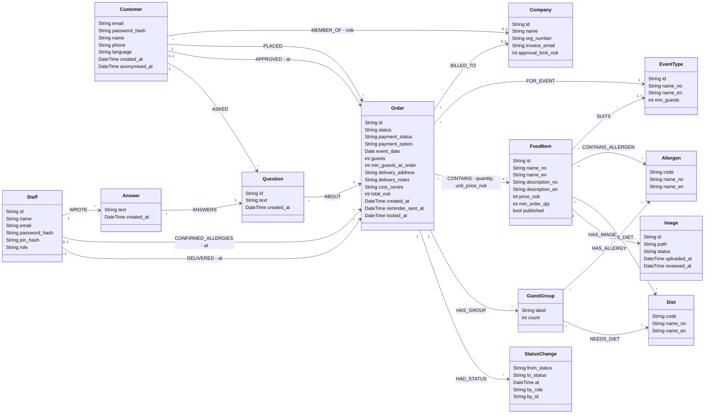

# Data model (Neo4j)

The graph data model for the Ekte Mat ordering system, drawn as a UML class diagram: each class is a **node label**,
each association is a **relationship type**. GitHub renders the Mermaid diagram below; a PNG copy is in
[`data_model.png`](data_model.png).

Built from the [user stories](../requirements/user_stories.md), the [state diagrams](state_order.md) and the
[decisions log](../decisions.md) (2026-10-27: basic login, NO/EN interface, no deposits, corporate accounts, kitchen and
driver screens). Storage is Neo4j (`CLAUDE.md`). Only `:EventType` is implemented in the backend so far.



`- role`, `- at` and `- quantity, unit_price_nok` on an association are **relationship properties**, for example
`(:Order)-[:CONTAINS {quantity: 25, unit_price_nok: 189}]->(:FoodItem)`.

## Nodes

| Label | Purpose | Notes | Stories |
|---|---|---|---|
| `:EventType` | Birthday, wedding, conference, … with its current minimum guests | `min_guests` 1–265; text in NO and EN | US-01, US-06, US-20 |
| `:FoodItem` | A dish or menu card | Text in NO and EN; only `published` items are shown | US-01, US-18 |
| `:Image` | Photo of a food item | `status`: `pending`, `approved`, `rejected`; only approved are public | US-19 |
| `:Allergen` | Fish, milk, gluten, nuts, celery, mustard, … | Fixed list, seeded | US-01, US-07, US-27 |
| `:Diet` | Vegetarian, vegan, gluten-free, halal, … | Fixed list, seeded | US-01, US-03, US-07 |
| `:Customer` | A person who orders, private or company user | `email` unique; `language` `no`/`en`; no reset-token fields (no e-mail reset, decision 2026-10-27) | US-04, US-08, US-31 |
| `:Company` | Corporate account | `approval_limit_nok` default 15 000 | US-13 – US-16 |
| `:Order` | One catering order | See values below | US-05 – US-11, US-21 – US-25 |
| `:GuestGroup` | A group of guests with the same allergies/diets, e.g. "4 guests, gluten-free" | Never linked to named guests (GDPR) | US-07, US-27, US-28 |
| `:StatusChange` | History of every status change: who, when, from, to | Audit trail for the state machine | US-15, US-22, US-25, US-30 |
| `:Question` / `:Answer` | Customer question about an order, and Ekte Mat's answer | | US-12, US-26 |
| `:Staff` | Ekte Mat users | `role`: `admin`, `kitchen`, `driver`; kitchen logs in with `pin_hash` | US-18 – US-30 |

### Value lists (stored as strings, checked by the backend)

| Property | Values |
|---|---|
| `Order.status` | `awaiting_company_approval`, `submitted`, `approved`, `in_preparation`, `delivered`, `rejected`, `cancelled` (see [state diagram](state_order.md)) |
| `Order.payment_status` | `not_paid`, `invoiced`, `paid` (`deposit_paid` reserved for later; no deposits in this version) |
| `Order.payment_option` | `invoice`, `vipps`, `bank_transfer` |
| `MEMBER_OF.role` | `orderer`, `approver` |
| `Staff.role` | `admin`, `kitchen`, `driver` |
| `Image.status` | `pending`, `approved`, `rejected` |

## Design choices

1. **Values are copied onto the order when it's placed.** `Order.min_guests_at_order` and `CONTAINS.unit_price_nok` keep orders valid and history unchanged when the admin later changes a minimum or a price (`basic_desc.txt`, US-06, US-18).
2. **Allergies are stored per guest group, not per named guest.** Allergy data about a named person can be health data under GDPR article 9 (GDPR note); per-group storage also matches Sunniva's need.
3. **Customers and staff are separate labels.** Customers register themselves; staff accounts are created by Ekte Mat and have roles and PIN login. This keeps customer self-registration from ever creating an admin.
4. **Company users are ordinary customers with a `MEMBER_OF` relationship.** The `role` on that relationship decides whether they can approve. `BILLED_TO` is set on company orders so the monthly invoice can be collected per company.
5. **Order status and payment status are separate properties** with separate state machines, so deposits can be added later without touching the order flow.
6. **Status history is stored as `:StatusChange` nodes.** The state machine says who may change what; the history records who actually did, which the admin, company approvers and disputes will need.
7. **Read-only orders are enforced in the backend.** Neo4j can't block updates on a node, so the repository layer refuses changes to orders in `delivered`, `rejected` or `cancelled`, or after `locked_at`.

## Constraints and indexes

```cypher
CREATE CONSTRAINT event_type_id   IF NOT EXISTS FOR (e:EventType) REQUIRE e.id IS UNIQUE;   // exists
CREATE CONSTRAINT food_item_id    IF NOT EXISTS FOR (f:FoodItem)  REQUIRE f.id IS UNIQUE;   // exists
CREATE CONSTRAINT customer_email  IF NOT EXISTS FOR (c:Customer)  REQUIRE c.email IS UNIQUE; // exists
CREATE CONSTRAINT order_id        IF NOT EXISTS FOR (o:Order)     REQUIRE o.id IS UNIQUE;   // exists
CREATE CONSTRAINT company_id      IF NOT EXISTS FOR (c:Company)   REQUIRE c.id IS UNIQUE;
CREATE CONSTRAINT staff_email     IF NOT EXISTS FOR (s:Staff)     REQUIRE s.email IS UNIQUE;
CREATE CONSTRAINT allergen_code   IF NOT EXISTS FOR (a:Allergen)  REQUIRE a.code IS UNIQUE;
CREATE CONSTRAINT diet_code       IF NOT EXISTS FOR (d:Diet)      REQUIRE d.code IS UNIQUE;
CREATE CONSTRAINT image_id        IF NOT EXISTS FOR (i:Image)     REQUIRE i.id IS UNIQUE;
CREATE CONSTRAINT question_id     IF NOT EXISTS FOR (q:Question)  REQUIRE q.id IS UNIQUE;
CREATE INDEX order_status_date    IF NOT EXISTS FOR (o:Order) ON (o.status, o.event_date);  // admin list (US-21), kitchen/driver day view
```

The first four already exist in `backend/scripts/seed.py`; the rest should be added when those features are built.

## Example queries

Kitchen screen for one day (US-27): portions per dish and allergies per guest group.

```cypher
MATCH (o:Order {status: 'in_preparation', event_date: date($day)})-[c:CONTAINS]->(f:FoodItem)
WITH o, collect({dish: f.name_no, portions: c.quantity}) AS dishes
OPTIONAL MATCH (o)-[:HAS_GROUP]->(g:GuestGroup)-[:HAS_ALLERGY]->(a:Allergen)
RETURN o.id, o.guests, dishes, collect(DISTINCT {group: g.label, count: g.count, allergen: a.code}) AS allergies
```

Guests already booked on a date (US-23 capacity):

```cypher
MATCH (o:Order {event_date: date($day)})
WHERE o.status IN ['submitted', 'approved', 'in_preparation']
RETURN sum(o.guests) AS booked
```

## Not in the model yet

- **Ingredients, recipes and suppliers** for Mateo's prep list and food origin (US-29, Ingrid's "where the lamb comes from"): `(:FoodItem)-[:USES {kg_per_portion}]->(:Ingredient)-[:SUPPLIED_BY]->(:Supplier)`.
- **Invoices** as their own nodes, if the monthly corporate invoice needs more than a payment status per order.
- **Deposits** (decision 2026-10-27): a `deposit_paid` payment status and deposit amount on `:Order`.
- **Password reset tokens** (decision 2026-10-27).
