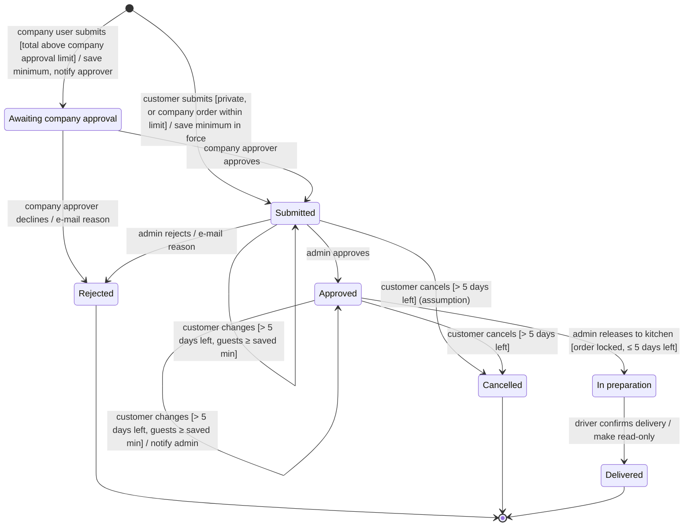
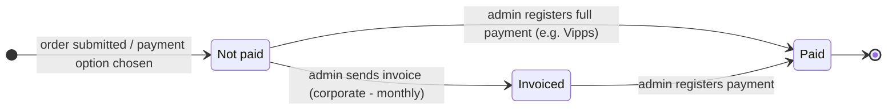

# State diagrams: order status and payment status

UML state machine diagrams for one order. GitHub renders the Mermaid blocks below; PNG versions are in this folder
([order](state_order.png), [payment](state_payment.png)).

Sources: [`basic_desc.txt`](../requirements/basic_desc.txt) (statuses, 5-day change/cancel limit, 7-day reminder,
read-only history),
[flowcharts](README.md#colour-coded-process-flowcharts-to-be) (admin releases the order to the kitchen after the lock),
[decisions log](../decisions.md) 2026-10-27 (corporate accounts with approval, no deposits in this version).

**How to read them:** boxes are states (an order is in exactly one at a time), arrows are transitions labelled
`event [guard] / action`, `[*]` is start or end. "> 5 days left" means more than 5 days before the event. Anything not drawn is not allowed, and the API should refuse it.

## Order status

### Allowed transitions (for the backend)

| From | To | Triggered by | Guard |
|---|---|---|---|
| (new) | `submitted` | customer | guests ≥ event-type minimum in force; private customer, or company order total ≤ company approval limit |
| (new) | `awaiting_company_approval` | company user | company order total > company approval limit; minimum saved on order |
| `awaiting_company_approval` | `submitted` | company approver | – |
| `awaiting_company_approval` | `rejected` | company approver | reason required |
| `submitted` | `submitted` | customer (change) | > 5 days before event; guests ≥ saved minimum |
| `submitted` | `approved` | Ekte Mat admin | – |
| `submitted` | `rejected` | Ekte Mat admin | reason required |
| `submitted` | `cancelled` | customer | > 5 days before event. *Assumption* (open question 1), built this way until the product owner decides |
| `approved` | `approved` | customer (change) | > 5 days before event; guests ≥ saved minimum |
| `approved` | `cancelled` | customer | > 5 days before event |
| `approved` | `in_preparation` | Ekte Mat admin | order locked (≤ 5 days before event) |
| `in_preparation` | `delivered` | driver / admin | – |

`rejected`, `cancelled` and `delivered` are final: no changes, no new transitions (history is immutable).

## Payment status

Payment isn't integrated in this version: the customer picks a payment option on the order and the admin updates the
payment status by hand. This is a separate state machine that runs alongside the order status. Corporate customers
get one invoice per month covering all their orders (Fjordtek interview).

**Deposits are out of scope for this version** (decision 2026-10-27). To add them later, insert a `Deposit paid`
state between `Not paid` and `Invoiced` / `Paid`; order status and payment status are kept separate, so this won't
affect the order status diagram. The value `deposit_paid` from `basic_desc.txt` is reserved for that.

## Open questions for the product owner

The diagrams show only what is decided. These gaps need an answer before the backend enforces the transitions:

1. Can a customer cancel a **submitted** order before it's approved? *The backend assumes yes for now (nothing has
   been approved yet).*
2. What happens to a **submitted** order that nobody approves before the 5-day lock? (Same for orders still awaiting
   company approval.) *For now it is locked like any other, and the daily e-mail to the admin lists it as not approved
   yet; the admin can still approve or reject it.*
3. Can the **admin** cancel an approved order, and how is the customer told?
4. Who confirms **delivery** in the system: the driver (own screen) or the admin?
5. **Company approval limit:** fixed at 15 000 NOK (Fjordtek) or set per company? Who is the approver, and can there be more than one?
6. **Change deadline for corporate orders:** Fjordtek wants changes until 10:00 the day before; `basic_desc.txt` says 5 days before for everyone. Which applies to corporate lunches?
